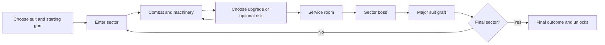

# BLACKSITE SHIFT — research and production plan

Prepared October 29, 2026. Planning basis: one developer using AI assistance. BLACKSITE SHIFT is the existing prototype's working name; final branding is undecided.

## 1. Recommendation

Build a **first-person, solo and 1–4 player cooperative roguelite shooter about a salvage crew descending through a hostile industrial facility**. Players graft recovered machinery into their suits, combine distinctive weapons and upgrades, and decide how much extra danger to activate for better rewards.

Use the oppressive, tactile industrial presentation of the three visual references as a starting point for an original art direction. Give the action the room-to-room clarity of a cooperative FPS, the escalating combinations of an item-driven roguelite, and deliberate weapon handling. The design should deliver a capable shooter in its first minute and a visibly transformed character by its final act.

For a solo developer, the first production goal is a **polished 15–20 minute cooperative slice**: one sector, one suit, three guns, four enemy types, one boss, eighteen standard modules, three major graft choices, and one compelling risk/reward interaction. Expand only after remote players enjoy that slice and its technical foundations hold up.

Recommended production candidate: **Unity 6 URP, C#, FishNet, and Steam lobbies/networking for the initial PC release**. Validate this combination in a bounded technical prototype before adopting it. Keep the existing JavaScript prototype available for design comparison. An engine change is a recommendation in this document, not a migration already performed.

## 2. Planning assumptions and evidence

### Confirmed by the request

- Solo developer with AI assistance.
- Roguelike shooter with multiplayer; first person preferred.
- Visual references: CloverPit, Project P.I.T.T., Lethal Company.
- Gameplay references: Deadzone: Rogue, Risk of Rain 1 and 2, Everything is Crab, Gunfire Reborn, Megabonk, SYNTHETIK.

### Proposed defaults

| Decision | Starting assumption | Reason |
| --- | --- | --- |
| Platform | Windows PC, Steam first | One distribution and social platform reduces integration work. |
| Multiplayer | Cooperative PvE, 1–4 total players | Fits the requested references and supports friend groups. |
| Perspective | First person throughout combat | Makes weapons, machinery and atmosphere immediate. |
| Session length | 30–45 minutes for a standard full run | Supports a substantial build without requiring a long evening. |
| Structure | Three sectors; authored rooms assembled into a variable route | Preserves combat quality while allowing replayability. |
| Progression | Most power earned inside the run; permanent unlocks add options | Friends with different playtime can play together. |
| Business model | Premium purchase; price tested later | Keeps the production and progression design focused. |
| Multiplayer hosting | One player hosts the authoritative simulation | Avoids operating a dedicated server fleet at launch. |
| Tone | Industrial dread, dry corporate humor, explosive action | Gives the references a coherent shared direction. |

Developer experience, weekly availability, cash budget, hardware targets and final name remain open. Estimates later in this document explicitly assume 30 focused project hours per week and some existing programming experience.

### Research method and limits

This is desk research using official developer/publisher store pages, official project sites, engine/networking documentation and Steamworks documentation. The reference matrix distinguishes documented features from design interpretation. I also read the local prototype's documentation and selected implementation areas and ran its existing tests.

I have not personally completed or benchmarked the ten reference games during this task. Store descriptions do not establish their hidden balancing rules, development costs, retention, or complete technical architectures. Visual proposals here are an interpretation of the requested direction, not measurements of those games' shaders or assets. Hands-on comparison remains a specific preproduction task. Dates, service terms and supported package versions should be checked again when implementation or release decisions are made.

## 3. What to take from each reference

The right synthesis selects a few responsibilities for each reference. Combining all of their systems would create competing combat rhythms and an unmanageable solo project.

| Reference and primary source | Documented foundation | Design interpretation for this game | Boundary |
| --- | --- | --- | --- |
| [CloverPit](https://store.steampowered.com/app/3314790/CloverPit/) | Confinement in a rusty cell; physical machines; debt pressure; items and combinations. | Make equipment and decisions tactile: terminals, switches, warning lamps and unsettling maintenance spaces. | Avoid adding a separate gambling game or reproducing its cell, machines or iconography. |
| [Project P.I.T.T.](https://store.steampowered.com/app/4026250/Project_PITT/) | A brutalist PSX-style corporate facility and physics-driven production systems. | Use monumental concrete, utilitarian machinery and environmental storytelling; a few machines should change encounters. | A general construction/automation sandbox is outside the shooter scope. |
| [Lethal Company](https://store.steampowered.com/app/1966720/Lethal_Company/) | Cooperative scavenging, industrial locations, a profit quota and communication between crewmates. | Give the squad recognizable work gear, meaningful shared risks and periods of tension between battles. | Its vulnerable scavenging pace is not the desired pace for every firefight. |
| [Deadzone: Rogue](https://store.steampowered.com/app/3228590/Deadzone_Rogue/) | Roguelite FPS combat, weapon/element/augment combinations, solo and up to three-player co-op. | Use it as the closest structural reference for readable first-person room combat and elemental builds. | Our proposed four-player capacity is our own scope choice. |
| [Risk of Rain (2013)](https://store.steampowered.com/app/248820/Risk_of_Rain/) | Its developer explicitly links rising difficulty to time and emphasizes replayable runs. | Make lingering and optional rewards meaningful decisions. | Pause pressure growth in designated safe rooms so co-op decisions are comfortable. |
| [Risk of Rain 2](https://store.steampowered.com/app/632360/Risk_of_Rain_2/) | Handcrafted locations, randomized stages/enemies/items, compounding loot and optional continued runs. | Build replayability from encounter and reward combinations, with a deliberate final escalation. | Fully procedural geometry and unlimited simulation growth are separate, optional projects. |
| [Everything is Crab](https://store.steampowered.com/app/3526710/Everything_is_Crab/) | Evolution and specialization produce different survival strategies and creature combinations. | Major suit grafts should change behavior, strengths and visible form. | Borrow the idea of adaptation; an ecosystem simulator and crab transformations are unnecessary. |
| [Gunfire Reborn](https://store.steampowered.com/app/1217060/Gunfire_Reborn/) | First-person roguelite/RPG structure, distinct heroes, randomized weapons/levels and four-player co-op. | Use a small number of suits with clear abilities and personal build choices. | Avoid launching with a large hero roster or several overlapping permanent talent systems. |
| [Megabonk](https://store.steampowered.com/app/3405340/Megabonk/) | Horde encounters, XP-based growth, randomized upgrade offers and item synergies. | Deliver frequent rewards and a clear transition from modest damage to powerful combinations. | Preserve manual aiming and deliberate firing as the shooter's main interaction. |
| [SYNTHETIK: Legion Rising](https://store.steampowered.com/app/528230/SYNTHETIK_Legion_Rising/) | Magazine ejection, active reload, heat/jams, movement-related recoil, customizable classes and two-player co-op. | Reward controlled bursts, precision and mastery; experiment with one optional timed reload mechanic. | Requiring every handling mechanic at once would fight the planned mobility and horde pace. |

### What these references imply together

1. Weapons must feel good before upgrades carry the experience.
2. A build should change what players do, not only its damage number.
3. Industrial atmosphere comes from proportions, materials, lighting, sound and interaction as well as image filters.
4. Cooperative decisions need deliberate rules for loot, menus, death and departures.
5. Readability must survive the strongest four-player build combination.
6. Replayability can come from authored content recombined by systems.

## 4. Product identity and design pillars

### Working premise

A contractor sends a maintenance crew into a sealed processing complex after its automated systems begin treating employees as raw material. Each descent recovers equipment, exposes the facility's purpose and gives the squad access to more dangerous machinery. The crew survives by adapting its own equipment faster than the facility escalates.

Story is delivered through signs, equipment descriptions, machine behavior and short announcements. A cinematic campaign is unnecessary for the first release.

### Four pillars

| Pillar | What the player experiences | A practical test |
| --- | --- | --- |
| Tactile guns | Distinct cadence, recoil, reload, impact and sound | Testers can distinguish the starter guns without looking at their names. |
| Visible adaptation | Suit grafts and upgrades change combat decisions | A player can explain how their current build differs from their previous run. |
| Shared industrial danger | The squad turns machinery on, manages space and takes optional risks | At least one memorable co-op moment arises from a decision rather than a random failure. |
| Controlled escalation | Encounters and combinations become spectacular while threats stay legible | Four players can still identify a dangerous attack during a heavily upgraded fight. |

### Signature mechanic: Overtime

At designated machinery, the squad can activate an optional Overtime condition for a better reward. Examples include unstable power routing, a faster reinforcement schedule, or a dangerous machine remaining active during combat. Show both the hazard and reward before commitment.

The vote applies to the squad. In a tie, keep the safer setting; the host cannot silently override it during combat. The chosen condition lasts for one encounter initially. Later, sector-long conditions can become an advanced mode.

This is the main feature to prove alongside the shooting. If it causes hesitation without interesting decisions, simplify or replace it before content production.

## 5. Run structure and pacing

### Standard full run

Target three sectors of approximately 9–13 minutes each, plus a short briefing and results flow. A normal sector contains **four combat rooms, one service room and one boss room**. Optional side encounters can replace a combat room or branch from the route; avoid making every run longer as content grows.

The route changes through room order, selected variants, enemy mixes, reward offers, optional branches and Overtime conditions. Boss arenas are authored to support reliable mechanics.

### Moment-to-moment rhythm

- Read the room and immediate threats.
- Shoot, move, use one suit ability and manipulate a limited number of machines.
- Decide whether to spend a resource or accept extra risk.
- Clear the encounter and choose the next direction.
- Pick upgrades at a safe moment and recognize their effect in the next fight.

Initial room duration hypothesis: 60–100 seconds, with 2–4 minute boss encounters. These values are tuning proposals, not measured reference-game averages.

### Rewards and menus

Give a standard upgrade choice after each of the four combat rooms in every sector: twelve normal draft choices over the full run. Each sector boss grants one major suit graft: three major choices. Shops and optional events add a small number of purchases or weapon changes. This creates fifteen guaranteed decisions plus optional rewards. Tune selection time so these choices support the action's rhythm.

Do not open mandatory selection menus during active combat. In cooperative safe rooms, stop threat growth and provide a ready check. Display who is ready, allow selections to be changed until departure, and provide a clear countdown only after everyone is ready. Any inactivity timeout should be visible and configurable for private groups.

### Threat pressure

The director uses sector progress, active encounter time and chosen Overtime conditions. Start with bounded steps rather than unlimited exponential scaling.

- Safe rooms and results do not increase pressure.
- Pressure mostly changes enemy composition, elite frequency and attack coordination.
- Health increases more slowly than combined player damage.
- Set an explicit maximum number of active enemies and simultaneous major attacks.
- Complete the standard run with an ending. An endless loop can be added after the bounded mode is balanced and profiled.

## 6. First-person movement and shooting

### Movement to build first

Responsive walking, sprinting, jumping and one short directional dash are sufficient for the slice. Retain a crouch interaction where it has a clear level-design purpose. Evaluate the existing prototype's slide after these fundamentals feel good.

Use a consistent collision capsule and a movement model that can be predicted on the client and reproduced by the host. Avoid making core navigation depend on intricate rigidbody movement or difficult platforming. Rooms should support flanking and elevation while allowing a new player to recover from a movement mistake.

Early tuning hypotheses: roughly 5 m/s walking and 7 m/s sprinting; a dash with a 2.5–4 second cooldown. Set final values in a scale-tested arena. Do not add wall running, grappling, double jumping and sliding together simply because they are individually appealing.

### Weapon feel checklist

Every weapon requires a recognizable firing cadence, muzzle/impact sound, recoil pattern, spread behavior, target response, reload animation, swap animation, viewmodel pose, controller behavior and remote-player presentation.

Use immediate local muzzle flash, audio and recoil when firing. Host-confirmed damage drives damage numbers and enemy death. Feedback must reconcile rejected shots without awarding damage locally.

Use a camera-to-aim-point check and a muzzle obstruction check so players cannot fire through a nearby wall because the camera can see around it. Verify aim at different aspect ratios, frame rates and fields of view.

Keep camera recoil and weapon animation separate. Provide adjustable sensitivity, ADS sensitivity and camera shake. Test a configurable horizontal FOV referenced to 16:9, with the exact convention explained in settings. Keep the crosshair readable at native UI resolution even with retro scene rendering.

### Handling depth

Start with a dependable single-button reload. Prototype an optional second press during a clear timing window that gives a short, modest bonus. A miss completes the ordinary reload; it should not lock a novice player out of firing for several additional seconds.

Give heat management to one or two weapons where it creates identity. Random weapon jams should remain outside the core release scope unless playtesting demonstrates that they add enjoyable decisions.

### Initial weapon families

| Family | Job | Distinctive behavior | Production concern |
| --- | --- | --- | --- |
| Service carbine | Baseline precision and sustained damage | Controlled bursts; reliable weak-point damage | Establishes the standard for gun feel. |
| Breach shotgun | Close range and stagger | Predictable spread; strong directional knockback | Pellets need aggregated hit feedback. |
| Arc projector | Crowd control and team setup | Short chain links with a visible target limit | Effect and proc limits are essential. |
| Rivet rifle | Heavy precision | Penetrates a limited number of targets | Requires clear line-of-fire rules. |
| Slag launcher | Area denial | Slow explosive payload and a short damage zone | Limit overlapping persistent areas. |
| Rotary cutter | Angles and corridors | A bounded ricochet or returning projectile | Consistent collision and ownership. |
| Coolant repeater | Slow and shatter setup | Applies a stackable chill threshold | Boss control resistance must be clear. |
| Unstable beam tool | High output with heat decisions | Continuous beam with a charge/vent cycle | Network and sound behavior differ from bullets. |

Only the first three are required for the slice. Final names and exact behaviors should be authored independently of the reference games. A gun earns its place through a different combat decision, not through a different damage stat alone.

Use two carried weapons. Keep the first implementation to one rolled weapon property and a clear comparison panel. More attachment slots and large inventories can wait until weapon switching and ordinary upgrades are already satisfying.

## 7. Builds, suit grafts and progression

### Three layers of build identity

1. **Suit:** starting ability, passive and initial gun. One suit for the slice; two for Early Access; three for the proposed full release.
2. **Run modules:** drafted items that modify attacks, defenses, movement or economy.
3. **Major grafts:** boss rewards that alter the player's combat approach and have a recognizable visual attachment.

All suits must be viable alone. A support suit should still have a complete damage and survival kit. Let groups choose duplicate suits; compulsory tank/healer composition is unnecessary.

Potential suits: a durable maintenance operator with a deployable barrier; a mobile surveyor with a marking pulse; a field engineer with a repair/arc device. Prototype the maintenance operator first. Existing prototype classes are useful comparisons, not a requirement to ship four complete characters.

### Six build directions

| Direction | Typical behavior | Tradeoff or weakness |
| --- | --- | --- |
| Precision | Weak-point hits reward aim and controlled fire | Lower output when surrounded or unable to aim. |
| Overpressure | Shotgun stagger, close-range blasts, armor breaks | Needs proximity and careful positioning. |
| Conduction | Shock links and marked-target interactions | Limited targets and individual burst damage. |
| Thermal | Heat, burn and short damage zones | Delayed damage and heat management. |
| Salvage | Drops, repairs and resource conversion | Some immediate offensive power is traded for sustain. |
| Momentum | Dash timing, reload opportunities and mobility rewards | Requires active execution rather than passive bonuses. |

### Example combinations to prototype

- **Live Circuit:** arc hits mark a target; precision hits on marked targets create a single additional arc. Give each target a short cooldown so four players cannot multiply it without limit.
- **Pressure Recovery:** a perfect reload powers the next close-range stagger; a stagger kill grants a brief barrier. Supports a recognizable reload-and-breach rhythm.
- **Thermal Salvage:** burn kills drop a small resource mote; collecting it vents the current heat weapon. The player must move into useful space to sustain damage.
- **Cold Fracture:** chill builds to a threshold; the next heavy hit shatters it for a bounded burst. Bosses take bonus damage without being permanently immobilized.
- **Emergency Bypass:** dashing through a marked machine briefly reroutes its hazard against enemies. Build this only after ordinary machine interactions are reliable.

These are original candidate designs and require playtesting. The slice needs at least three working build routes; it does not need all five examples.

### Draft rules

Offer three choices with clear numbers and behavior descriptions. Use lightly weighted build tags, a general option and a wildcard. Prevent offers for already capped items. Add one limited reroll or conversion into a modest resource so a poor draft does not force a useless choice.

Track whether a useful enabling item appears early enough. Avoid making a build depend on drawing one specific rare item from a large unrestricted pool. Unlock new items in curated groups to maintain a usable pool for new players.

### Stacking and effect rules

Define stack caps, additive/multiplicative categories, cooldown floors and target limits before increasing the item count. Show current and next-stack effects in the UI.

An initial damage model can multiply base weapon damage by a small number of named categories: weapon bonuses, critical result, target vulnerability and resistance. Keep bonuses inside a category additive. Use diminishing returns for cooldown reduction, dodge and damage reduction, with explicit caps.

Derived on-hit damage cannot create another on-hit proc by default. Allow carefully authored on-kill chains with a maximum generation count, per-target cooldowns and per-tick budgets. Every event carries its owner, original source and generation. This prevents infinite loops, duplicate rewards and effects whose cost grows with every enemy.

### Permanent progression

Unlock alternative suits, starting guns, new item groups, cosmetic equipment, challenges and difficulty modifiers. Give the starter equipment a complete winning path.

Avoid permanent damage growth that makes a veteran's baseline vastly stronger than a new friend's. If a small introductory stat track is retained, cap it early and disclose its effect on cooperative balancing. Difficulty should not be a substitute for grinding mandatory stats.

At death, retain earned unlock progress and discovery records. Lose the temporary build. At a successful finish, show the build, key events, damage/support contributions and unlocks without making raw damage the only measure of usefulness.

## 8. Enemies, encounter direction and bosses

### Build roles before variants

| Role | Pressure it creates | Telegraph and counterplay | Priority |
| --- | --- | --- | --- |
| Pursuer | Makes the player move | Audible approach, visible melee preparation, staggerable | Slice |
| Ranged worker/drone | Creates a firing lane | Visible projectile and firing pose; cover breaks the lane | Slice |
| Armored bruiser | Controls close space | Slow commitment, exposed recovery or weak point | Slice |
| Support unit | Changes target priority | Clear link to the enemy it protects or repairs | Slice |
| Charger | Punishes predictable movement | Locks direction before rushing; misses create an opening | Early Access |
| Artillery | Displaces entrenched players | Marked destination and travel time | Early Access |
| Flanker | Tests awareness | Distinct sound and a limited flank route | Early Access |
| Shield unit | Changes angles | Readable shield arc, stagger or side exposure | Early Access |
| Specialist variants | Add sector-specific behavior | Distinct silhouette or equipment and one new rule | Full release |

Avoid filling out the roster with health and color variants alone. An elite modifier should change one understandable rule and leave a useful reward. Start with two elite modifiers and expand after observing their combinations.

### First-person fairness

A first-person player cannot see an entire arena. The encounter director therefore needs attack coordination, not just a spawn budget.

- Limit simultaneous close-range attacks against one player.
- Reserve distinct sound cues for off-screen threats.
- Give dangerous off-screen attacks a warning and time to react.
- Avoid spawning an enemy directly behind the player without a visible or audible entrance.
- Use sight lines and distance when choosing ranged attacks.
- Prevent overlapping major hazards from covering every escape route.
- Make enemies reacquire a target after a player leaves or dies.

These are proposed fairness rules. Tune them with recordings of real players, especially during revives and four-player boss fights.

### Boss production standard

Each boss needs at least three clearly different attacks, a recognizable recovery opportunity, a positional mechanic and a change in behavior as the fight progresses. Build one thoroughly before creating three.

First boss candidate: **a processing foreman mounted on a moving gantry**. It sweeps a marked lane, launches slow pressure vessels and exposes a core after a machine cycle. Players can reroute one valve to create an opening, with equivalent solo interaction timing. Overtime can keep an additional hazard active for an enhanced graft reward.

Use a dedicated arena with several escape routes and readable scale. Check every attack from the furthest player position, behind partial cover and during a teammate revive. Multiplayer damage increases should not produce an exhausted, repetitive boss fight.

## 9. Level generation and environmental interaction

### Recommended generation method

Author room modules and encounter variants. Generate a small route graph, assign compatible rooms, choose encounter budgets and populate rewards. Keep geometry construction constrained and inspectable.

The host sends the selected room manifest, variant IDs and relevant state. A seed is useful for reproducing selection, but a seed alone does not synchronize physics or guarantee identical results across versions.

Every room record should include door sockets, dimensions, collision bounds, navigation data, encounter anchors, spawn exclusion volumes, usable machines, lighting setup and performance metadata.

### Generation sequence

1. Choose sector and route structure from a small set of graph templates.
2. Assign start, service and boss rooms to guaranteed locations.
3. Fill combat slots using room compatibility and repetition limits.
4. Connect and validate door sockets and collision bounds.
5. Verify every required objective and exit is reachable.
6. Check navigation and enemy spawn locations.
7. Assign rewards and optional risks using a separate random stream.
8. Send a versioned manifest and wait for all clients to finish loading.
9. Use a known valid fallback layout if validation fails.

Separate random streams for layout, encounters, rewards and cosmetic variations. Adding a new decorative prop should not change a recorded run's loot sequence.

### Room design rules

Provide a central combat space, at least two movement routes, clearly indicated exit doors and useful cover that does not turn into a maze. Use verticality sparingly: ramps, balconies and pits with deliberate gameplay support. Doorways must accommodate four players, projectiles and large enemy navigation.

Begin with one authored connected route. Build procedural assembly only after this route demonstrates enjoyable fights. When adding generation, run thousands of layout validations automatically and retain failing seeds/manifests for inspection.

### Machinery scope

Use a small vocabulary of reliable interactions: open/close a gate, reroute a hazard, trigger a conveyor, discharge a capacitor, or enable Overtime. Replicate the state of important machines. Decorative debris and most ragdolls can remain cosmetic.

Avoid a general-purpose networked physics sandbox. For the slice, one combat-changing machine and a few doors are sufficient. Place a strict budget on simultaneously active movable gameplay objects, and define what happens if an object blocks an exit.

## 10. Art direction, audio and presentation

### Visual brief

**An abandoned industrial workplace built from oversized concrete and steel, rendered with deliberate low-detail surfaces, harsh practical lighting and equipment that looks physically operated.** The crew's recognizable silhouettes gradually acquire irregular mechanical grafts.

The requested visual references suggest confinement, industrial scale and worksite unease. Our implementation should establish its own signage, suits, symbols, machines and creature shapes. Reference images belong in a private analysis board with source links; exported production assets should be original or appropriately licensed.

### Concrete art rules

| Area | Proposed direction | Readability constraint |
| --- | --- | --- |
| Geometry | Bold forms, large machines, visible pipes and supports, selective asymmetry | Cover edges and navigation remain clean. |
| Materials | Painted metal, stained concrete, rubber, oxidized steel | Reduce busy texture detail around targets. |
| Palette | Soot gray, dirty cream, oxidized green, rust and warning amber | Reserve stronger accents for threats, interactions and team information. |
| Textures | Small texture sheets, trim sheets and decals; approximately 128–512 px for many props | Close-up weapons and key labels receive enough detail to read. |
| Lighting | Fluorescent pools, work lamps, deep but navigable shadow, limited fog | Enemies separate from the background in every quality mode. |
| Characters | One base work suit with modular equipment and strong head/shoulder silhouettes | Teammates remain identifiable through graft changes. |
| UI | Terminal-inspired typography and physical machine panels | Menus and combat text remain sharp and scalable. |
| Effects | Brief muzzle flashes, compact impacts, bounded arcs and readable warning shapes | Friendly effects cannot obscure major enemy tells. |
| Retro treatment | Optional pixelation, modest dithering and controlled color grading | Scene treatment does not reduce UI clarity or aiming precision. |

These dimensions and style rules are our proposed asset standards, not the references' documented specifications. Use a representative room to determine the actual texture density and geometry budgets.

### Avoiding the dark-screen problem

Provide brightness calibration, a usable default flashlight or ambient floor, and consistent threat silhouettes. Use shape, animation and audio in addition to color. A dangerous projectile needs to be readable against both a bright furnace and a dark hallway.

Camera shake, head bob, motion blur, chromatic aberration and aggressive retro filters should be adjustable or disabled. Build the atmosphere so it survives those settings being reduced.

### Art slice deliverables

- One modular environment kit with a floor, wall, ceiling, doorway, support and pipe vocabulary.
- One finished reference room and one short transition space.
- One first-person arm rig and one visible third-person crew rig.
- Three complete weapon presentations, including animations and sound.
- Four enemies with complete combat tells, hit reactions and death behavior.
- One boss and dedicated arena.
- Three major graft attachments or clearly distinct graft presentations.
- A coherent UI style sheet, icon vocabulary and readable upgrade cards.

Modeling a low-poly object is only part of completion. Rigging, animation, collision, materials, import setup, remote representation and performance checks also consume time.

### Audio direction

Build contrast between quiet machinery, distant movement and close weapon impacts. Prioritize important enemy warnings over the combined weapons of four players. Use a voice/priority budget so repeated effects do not drown out boss cues.

Each gun needs separate local and distant/remote sound behavior. Rooms need coherent reverberation or simplified zone effects. Music can add layers as an encounter escalates, then leave breathing room after completion.

Begin with a small library of well-chosen licensed sounds and a few original signature recordings or commissioned effects. A good shotgun report, reload and target response can improve the slice more than several additional unfinished guns.

## 11. Cooperative rules and user experience

### Session lifecycle

Host creates a private or friends lobby; others join through Steam invitations or the game's lobby interface. Select suits and rules, ready up, load the run, play through sectors, receive results, then return to the same lobby.

The public experience should not require typing a host's IP address or changing router settings. Steam's lobby system and transport solve different parts of this: lobbies assemble players; networking carries the simulation messages. See [Steam lobbies](https://partner.steamgames.com/doc/features/multiplayer/matchmaking) and [Steam networking](https://partner.steamgames.com/doc/features/multiplayer/networking).

### Rules to implement explicitly

| Situation | Proposed rule |
| --- | --- |
| Player count | One to four; solo uses the same combat rules and local authority. |
| Personal upgrades | Each player drafts their own reward. |
| Scrap | Each player receives a personal share so fast looting does not decide build strength. |
| Team objective resources | Shared and visible to everyone; spending follows the relevant vote or interaction rule. |
| Weapon drops | Personal ownership initially; deliberate gifting can be added later. |
| Friendly fire | Off by default; an optional advanced modifier after balance testing. |
| Duplicate suits | Allowed. |
| Doors and physical blocking | Teammates cannot trap one another in a required doorway. |
| Downed state | A readable recovery window and interruptible revive. |
| Eliminated player | Spectates with pings and returns at the next sector checkpoint with a viable baseline. |
| Solo recovery | One limited self-recovery resource or a clearly tuned alternative. |
| Late join | Lobby and sector safe rooms initially; joining during active combat waits for a safe boundary. |
| Reconnect | Reserve a disconnected slot briefly and restore that player's authoritative run state if the host is still active. |
| Host departure | Warn before intentional departure; end the session cleanly and offer the most recent valid checkpoint where supported. |
| Suspension | Save only at designed safe boundaries; restoration rules must be clear before choosing Suspend. |
| Pause | Full pause in solo; private co-op pause only with an agreed squad rule. |
| Public lobbies | Add after the private flow is stable; include version/rules filters, kick and block behavior. |

The slice can respawn eliminated players at its boss entrance, serving as that sector's checkpoint. Full release checkpoints should be consistent rather than depending on arbitrary room completion.

### Co-op scaling

Start from a solo encounter budget. Add a mixture of modest health scaling, more composition variety and additional enemies as players join. Do not multiply every enemy's health by four. Bosses can gain moderate health and additional attack opportunities, bounded by first-person readability.

Recalculate for player departures at a safe boundary. Joining players should arrive with an appropriate sector baseline and a small curated catch-up draft. Preserve an existing player's personal build on reconnect. Scale for participating players rather than treating an empty disconnected slot as a fully active fighter.

### Communication

Pings for enemy, danger, loot, route and revive are required. Key information must be understandable without voice. Test the slice with external voice chat; built-in team or proximity voice is a later priority unless testers show it is central to the experience.

If built-in voice is adopted, include push-to-talk, mute, individual volume, device selection and a clear indication of who is speaking. Voice routing, occlusion and mixing require their own testing; installing a transport does not provide this complete experience.

## 12. Engine choice and technical architecture

### Engine comparison for this project

| Candidate | Advantages for this plan | Work and risks | Recommendation |
| --- | --- | --- | --- |
| Unity + URP + C# | Component authoring, a substantial tooling/asset ecosystem, an appropriate rendering pipeline and several networking options | Package compatibility, editor learning and networking integration still need deliberate work | Preferred candidate when no stronger existing engine expertise overrides it. |
| Godot 4 | Compact workflow, accessible scene tools and a documented high-level multiplayer API | Prediction, shooter-specific tooling and Steam integration need careful evaluation | Strong alternative if Godot experience or tooling preferences are compelling. |
| Unreal Engine | Established replication and shooter-oriented systems | A larger editor/content pipeline and potentially substantial complexity for one developer | Prefer if the developer already knows Unreal well. |
| Existing Three.js/Node/Electron prototype | Runs now; fast code iteration; contains useful combat experiments | Many authoring, animation, collision, online-service and profiling workflows would remain custom | Retain for design research; consider shipping this route only after equivalent quality/performance tests. |

This ranking is a project judgment, not a benchmark proving one engine faster. Prior experience can outweigh general tooling advantages. [Godot networking documentation](https://docs.godotengine.org/en/stable/tutorials/networking/high_level_multiplayer.html) and [Unreal networking overview](https://dev.epicgames.com/documentation/unreal-engine/networking-overview-for-unreal-engine?lang=en-US) both provide valid foundations.

### Recommended candidate stack

- Unity 6 with URP, C# and a deliberately small package set.
- Use a supported editor version and pin its exact patch. Unity's reviewed support page lists 6.3 LTS through December 2027; revisit support and package compatibility before locking a production that may run beyond that date. [Unity release support](https://unity.com/releases/unity-6/support)
- FishNet for authority, movement prediction, state replication and scene handling. Its documentation identifies built-in prediction and separates paid lag compensation features. These are capabilities to evaluate, not evidence that integration will be automatic. [FishNet features](https://fish-networking.gitbook.io/docs/overview/readme/features)
- Local transport during early development; evaluate FishySteamworks with Steamworks.NET for Steam play. The documented dependency and supported platforms should be checked against the selected package versions. [FishySteamworks](https://fish-networking.gitbook.io/docs/fishnet-building-blocks/transports/fishysteamworks)
- Steam lobbies, invites and Steam networking/relay for the Steam release. Verify that the selected transport actually uses the intended modern networking API and relay behavior.
- ScriptableObject definitions or similarly validated data assets for weapons, items, enemies, encounters and rooms.
- Source control, large-file support for binary source assets, repeatable builds and a separate testing branch.

URP is Unity's prebuilt pipeline for scalable graphics. It is suitable for the proposed style without requiring a high-end rendering feature set. [URP introduction](https://docs.unity.com/en-us/engine/6000.0/manual/render-pipelines/universal-render-pipeline/urp-introduction)

### Networking alternatives and cost boundaries

Unity's Multiplayer Services SDK with Netcode for GameObjects is another valid candidate. Its official session tutorial integrates services including Relay and Lobby, which contribute to service billing. The NGO 2.4 documentation reviewed here describes anticipation rather than a complete prediction/reconciliation loop; verify the selected current version before treating it as a ready-made fast-FPS controller. [Unity sessions tutorial](https://docs.unity.com/en-us/mps-sdk/tutorials/build-your-first-session), [NGO 2.4 anticipation](https://docs.unity3d.com/Packages/com.unity.netcode.gameobjects@2.4/manual/advanced-topics/client-anticipation.html)

Choose one supported path after the technical prototype. Maintaining Steam, Unity services, EOS and a custom backend together would multiply solo maintenance work. FishNet add-ons and paid features need a license/version review before purchase or adoption.

Unity Personal has financial eligibility conditions; its current product and license pages should be checked against the developer's actual circumstances. Unity has canceled its Runtime Fee. Engine eligibility does not make every online service or third-party asset free. [Unity plans](https://unity.com/products), [license eligibility](https://unity.com/pages/license-compliance), [Runtime Fee cancellation](https://unity.com/blog/terms-update-runtime-fee-cancellation)

### Host authority and responsiveness

The host decides movement validation, ammunition, firing cadence, damage, enemy decisions, loot, objective state, random rewards, revives and transitions. Clients send action intent with sequence/timing information. The local player predicts movement and immediate firing presentation, then reconciles with authoritative results. Other entities interpolate authoritative snapshots.

Host authority prevents a remote client from freely awarding itself damage or rewards. The hosting player's machine is still trusted; this model does not provide a cheat-proof competitive economy.

For hitscan weapons, evaluate limited enemy-position rewind under measured latency. FishNet lists lag compensation as a Pro feature, so budget for the relevant feature or a separately validated implementation if the shooting tests require it. Keep a clear time-window bound and host validation. Do not assume movement prediction also solves hit registration.

For simple projectiles, send a spawn event and authoritative impacts while clients simulate cosmetic flight. Use corrections for long-lived or changing trajectories. Beams, ricochets and persistent damage zones need their own state rules. Replicate important decisions; do not replicate every particle.

### System boundaries

| System | Responsibility |
| --- | --- |
| Session service | Lobby lifecycle, identities, invites, version/rules checks and reconnects |
| Run controller | Phase transitions, sector progress, ready checks and checkpoints |
| Player motor | Input, prediction, authoritative movement and reconciliation |
| Weapon system | Fire/reload/swap state, ammunition and authoritative hit requests |
| Damage/effect system | Damage categories, status effects, ownership and proc budgets |
| Build system | Offers, tags, stacks, grafts and serialization |
| Encounter director | Spawn budget, attack coordination, scaling and completion |
| Enemy controller | Role behavior, navigation, tells and death |
| Room system | Room manifests, generation validation, loading and navigation |
| Interaction system | Machine state, use conditions and objective resources |
| Presentation | Viewmodels, remote bodies, sound, effects and HUD |
| Persistence | Profiles, versioned saves, backups, migrations and reward deduplication |
| Diagnostics | Build IDs, logs, timing, network counters and reproducible run data |

Separate content definitions from runtime state. Use stable content IDs and a content/version hash. A save should not depend on an object's scene name or array order.

### Save design

Profiles store unlocks, settings and discovery. A suspended run stores a schema version, run ID, content version, seed/manifest, checkpoint, pressure, rewards already granted and player builds. Use atomic writes and retain a last-known-good backup.

Checkpoint recovery restores a designed safe state, not an arbitrary frame of networked combat. Reconnecting to a live host and resuming a saved run are separate features. A new lobby owner does not automatically become the simulation host. Full live host migration is deferred unless its cost becomes justified.

Allow offline solo play without a relay or account-server request. Cloud synchronization, when added, needs a conflict policy and must not silently overwrite the only valid save.

## 13. Performance and network budgets

These are **engineering targets to validate**, not achieved benchmarks or final minimum requirements.

| Area | Starting target |
| --- | --- |
| Display | 1080p at a stable 60 FPS on a representative modest gaming PC |
| Reference test profile | Approximately a Ryzen 5 3600 / GTX 1660 class machine with 16 GB RAM; use owned/tester hardware where possible |
| Frame time | 16.7 ms total budget, with headroom during the strongest tested build |
| Simulation | Prototype at 60 Hz; evaluate 30 Hz only if responsiveness and profiling support it |
| AI decisions | Lower-frequency decisions, such as 5–10 Hz, with smooth movement and scheduled attacks |
| State updates | Approximately 15–20 Hz initially, separate from simulation and rendering |
| Active enemies | Around 24–32 in ordinary combat; 48 in peaks; 64 in stress tests |
| Gameplay projectiles | Establish a measured cap; begin stress tests around 200, with effects separately limited |
| Bandwidth | Initial ceiling of roughly 100 KB/s per remote client in ordinary worst-case play; measure actual traffic and overhead |
| Host upload | With three remote clients, that ceiling implies about 300 KB/s, or 2.4 Mb/s, before overhead |
| Session soak | Repeated complete runs plus a two-hour stress session without growing entity/memory counts |

Pool projectiles, damage text and frequent effects. Use distance/visibility relevance, compact state, static room data sent once, shared materials, controlled light counts and cheap collision where appropriate. Apply rate limits to effect presentation as well as simulation.

Measure the host while it also renders and plays. Test remote clients on different hardware. A low-poly scene can still be slow because of transparent effects, dynamic shadows, per-enemy logic, allocation or networking.

The stress scene must contain four active builds, stacked status effects, enemy deaths, drops, boss attacks and machinery together. A clean empty arena is insufficient evidence.

## 14. Existing prototype assessment

### What is present

The current folder contains a Three.js-rendered first-person game, a Node server, an Electron wrapper and a Windows packaging script. Content definitions include four classes, ten weapons, thirty-two augments, three sector layouts and class talents. Server code handles combat, projectiles, enemy effects and shared room state. Movement messages currently report positions subject to host checks; this is not the same as a full input replay/reconciliation system.

The server advances with a 1/60-second step and sends snapshots on a roughly 0.1-second schedule. Its layouts/collision are largely based on a horizontal grid, with projectile height represented separately. General multilevel navigation and arbitrary 3D combat spaces would need additional work.

Settings and class selection use local browser storage. The reviewed code/docs do not provide a production profile/unlock save system, Steam lobby/relay integration, or live host migration. The transport is a custom WebSocket implementation suitable for further evaluation as a prototype, with public-hosting hardening still required.

Local evidence: `README.md`, `GAME_GUIDE.md`, `DESIGN_NOTES.md`, `package.json`, `desktop.js`, `server.js`, `public/shared.js`, `public/game3d.js`, and `tests/multiplayer.test.js` in this workspace.

### Verification performed

The existing test suite passed **11 of 11 tests**, including a simulated four-client integration test, when local loopback connections were allowed. The first sandboxed attempt passed ten tests and could not establish the integration connection; a focused diagnostic returned `EACCES`. Re-running with local connection permission passed the complete suite.

These tests provide useful evidence for current simulation behaviors. They do not establish internet NAT/relay connectivity, visual quality, gun feel, frame rate, packet-loss behavior, save reliability or an actual four-person remote play session. I have not represented those as verified.

### What to preserve and how

| Prototype asset | Recommended use |
| --- | --- |
| Weapon and class definitions | Starting hypotheses and comparative tuning data |
| Elemental interactions and upgrade examples | Candidates for a smaller, carefully validated production pool |
| Existing tests | Behavioral requirements to reproduce where their rules survive |
| Room-code flow | Early usability reference; replace direct-IP requirements in the public flow |
| Current executable | A retained playable baseline for design comparison |
| Art/geometry code | Reference and possible temporary assets; review portability individually |
| Server implementation | Learning and behavioral reference; production architecture depends on the chosen stack |

Before substantial implementation, create a recoverable version-control baseline and document how to reproduce the current executable. The working files appeared untracked at inspection, so this step matters. This planning task adds documents and does not perform a source migration or rewrite.

## 15. Scope by milestone

These counts describe production-ready content, including presentation, networking, tuning and testing. Prototype definitions already present in the folder do not automatically count toward them.

| Deliverable | Polished slice | Early Access candidate | Proposed full release |
| --- | --- | --- | --- |
| Play time per complete route | 15–20 minutes | 20–35 minutes | 30–45 minutes |
| Sectors/environment kits | 1 | 2 | 3 |
| Room templates, including utility and boss rooms | 8 | 18 | 27 |
| Suits | 1 | 2 | 3 |
| Weapon families | 3 | 6 | 8 |
| Standard run modules | 18 | 36 | 60 |
| Major graft choices | 3 | 6 | 9 |
| Regular enemy types/meaningful variants | 4 | 8 | 12 |
| Bosses | 1 | 2 | 3 |
| Elite modifiers | 1 | 2 | 4 |
| Overtime conditions | 1 | 3 | 5 |
| Session support | Solo and 1–4 friends | Robust private play; public lobbies if ready | Reliable private/public flow |
| Persistence | Settings, test profile, basic checkpoint proof | Profiles, migrations, reconnect and safe-boundary suspend | Hardened recovery and optional cloud sync |
| Input | Mouse/keyboard plus early controller testing | Complete keyboard/controller flow | Tuned, remappable input and tested menu navigation |
| Presentation | One coherent sector at representative quality | Consistent quality across two sectors | Complete art/audio/UI pass |

The slice is one sector with an intentionally more generous traversal/learning pace. It is a representative sample, not a promise that three sectors will take an hour. Test the actual room count and reward rhythm before treating a duration as fixed.

### Defer from the initial production commitment

PvP; cross-store/console crossplay; large open worlds; general construction; destructible buildings; eight-player sessions; live host migration; a dedicated hosting fleet; competitive leaderboards; full mod support; VR; a cinematic campaign; a large hero roster; extensive procedural mesh generation; and built-in proximity voice.

Any one of these can become a later project. Adding it requires an explicit scope exchange and new verification, especially where it changes networking or content assumptions.

### Cut order if production is late

Reduce the number of suits first, then secondary weapon families, then standard module count and room variants. Keep distinct boss mechanics, reliable connectivity, readable attacks, save recovery and finished weapon feedback. A coherent two-sector release is preferable to promising a third sector that is not enjoyable yet.

## 16. Production sequence and decision gates

The sequence follows the main dependencies: **recoverable baseline → movement/network proof → gun feel → damage and effects → enemies → encounters → builds → complete run → saves/recovery → content production → public verification**. Style exploration and small art tests should begin early, then feed the same playable slice.

### M0 — Direction, baseline and technical choice

**Estimated base effort: 40–60 focused hours.**

Tasks: preserve the prototype, reproduce its build, select a small set of reference questions, sample the reference games where available, define input/scale/visual targets, create a graybox test room and run the engine/networking proof.

The networking proof needs two separate machines and accounts where appropriate. Demonstrate moving, firing at one enemy, taking damage, completing a room and returning to the lobby. Simulate latency and loss. Confirm the Steam transport's intended networking API, version compatibility and offline solo behavior.

**Gate:** commit to a stack only after the remote player has responsive movement and consistent basic combat. If the preferred stack fails, timebox a comparison with the strongest alternative before investing in production content.

### M1 — Combat foundation

**Estimated base effort: 80–120 focused hours.**

Build the player motor, basic shooting, reload/swap, three graybox guns, a damage/effect core, enemy health/death, two initial enemy behaviors, telegraphs and a simple encounter loop. Add the profiler/network counters and a repeatable stress setup now.

Test 60, 100 and 150 ms round-trip delay and packet loss. Record discrepancies. Resolve gun obstruction and prediction corrections before extending the movement set.

**Gate:** players enjoy a five-minute encounter with no progression rewards. They can tell the weapons apart and explain dangerous attacks. Host and remote results agree.

### M2 — Complete polished slice

**Additional base effort: 180–320 focused hours. Cumulative base effort: 300–500 hours.**

Build the remaining slice enemies, boss, room transitions, upgrade drafts, eighteen modules, three grafts, one Overtime machine, one environment kit, complete weapon/character presentation and a coherent menu/HUD. Add the first save schema and reconnect/checkpoint proof. Package a repeatable test build.

Begin with an authored connected route; introduce constrained room assembly only once the route is fun. Test at least three meaningful builds. Use outside players and real home networks.

**Gate:** a new player completes the loop without developer narration, understands a build, and wants another run. Four-player worst-case combat meets the chosen performance target. There are no known routine run blockers.

### M3 — Early Access systems and content

**Additional base effort: 450–700 focused hours. Cumulative base effort: 750–1,200 hours.**

Finish production room assembly/validation, implement the second sector and suit, expand to the Early Access content budget, complete profile/unlock progression, improve enemy composition, and finish robust private lobbies, reconnect, safe-room suspend and controller navigation.

Add public lobbies only after private invitations are reliable. Plan the store page once representative art/gameplay can support honest screenshots and a short trailer. Start a controlled playtest and track issues by impact.

**Gate:** complete runs with varied builds, stable saves across the supported upgrade path, clean incompatible-version errors and repeated successful four-person internet sessions. Content earns its place through playtest evidence.

### M4 — Early Access readiness and release

**Additional base effort: 150–300 focused hours. Cumulative base effort: 900–1,500 hours.**

Resolve critical bugs, tune onboarding and difficulty, test low/medium/high quality settings, check audio and accessibility, complete store assets and disclosure fields, validate clean installation and update behavior, and run release-candidate tests.

**Gate:** the game already provides enough reliable enjoyment to justify its asking price. Future features should enhance that value. Valve's Early Access guidance requires a playable product that is worth its current state. [Steam Early Access](https://partner.steamgames.com/doc/store/earlyaccess)

### M5 — Full release

**Additional base effort: 900–1,500 focused hours. Cumulative base effort: 1,800–3,000 hours.**

Complete the third sector, final suit/weapon/module budget, final encounter and ending, challenge/difficulty options, supported languages, save compatibility and a full consistency/performance pass. Use Early Access evidence to replace weak content before increasing the count.

**Gate:** the complete stated product is present, the main loop has no known routine blockers, recovery paths are reliable, and the reference test matrix passes on release builds. Release with a support plan and time reserved for patches.

## 17. Timeline and budget

### Time estimate

The effort ranges above are planning estimates, not research-derived averages or commitments. Add **25% contingency** for integration, rework and discoveries. They include development and content work; irregular availability and a developer's learning curve can extend calendar time further.

| Milestone | Base cumulative hours | With 25% contingency | At 30 focused hours/week | Practical calendar planning range |
| --- | --- | --- | --- | --- |
| Polished slice | 300–500 | 375–625 | 13–21 weeks | About 4–6 months |
| Early Access candidate | 900–1,500 | 1,125–1,875 | 38–63 weeks | About 10–16 months |
| Full release | 1,800–3,000 | 2,250–3,750 | 75–125 weeks | About 18–30 months |

At 12 focused hours per week, the same full-release estimate becomes approximately 188–313 weeks, or 3.6–6 years. Smaller scope or paid specialist help can change that. A beginner should recalibrate after the combat milestone using measured throughput rather than assuming the low end.

AI assistance is already assumed. It can speed bounded implementation, data authoring and diagnosis. It does not make animation review, sound selection, integration, debugging or player observation disappear. Measure completed, tested features rather than generated code volume.

### Cash planning example

These are illustrative allowances for a lean project, not vendor quotes. They exclude the developer's labor/living costs, taxes, revenue-based engine plan changes and substantial custom contracting.

| Cost area | Planning allowance, USD |
| --- | --- |
| Tools and carefully selected production assets | $300–1,500 |
| Sound effects and music licenses | $200–1,200 |
| Targeted art/animation help | $1,000–5,000 |
| Outside QA, accessibility checks and limited localization | $500–2,500 |
| Capsule art, trailer polish and promotional materials | $300–1,500 |
| Steam Direct fee | $100, subject to applicable local taxes/currency |
| Additional testing hardware/access | $0–1,200 |
| Subtotal | $2,400–13,000 |
| 25% contingency | $600–3,250 |
| Total illustrative allowance | **$3,000–16,250** |

The current documented Steam Direct fee is $100 USD per app, or equivalent. [Steam Direct Fee](https://partner.steamgames.com/doc/gettingstarted/appfee)

For the first slice, cap discretionary purchases around $300–1,500 until the core works, using existing/free licensed material where appropriate. The most valuable first commission may be weapon animation/audio or a focused networking review. Re-estimate with actual quotes after the slice.

A Steam-first player-hosted architecture reduces the need to rent gameplay servers. It still needs integration, operational testing and a cost review for any added relay, voice, crash-reporting or backend service. Do not assume that a relay runs the simulation or preserves a departed host's game.

An eventual premium price around $14.99–19.99 is a hypothesis to test against the quality and content of the demo. It is not a revenue forecast, a claim about current competitor pricing, or a release decision.

## 18. Verification and playtesting plan

### Automated checks with meaningful value

- Damage categories, armor/resistance limits, stack caps and cooldown floors.
- Status application, expiration, ownership and proc recursion limits.
- Seed/manifest reproducibility within a pinned content version.
- Reachability, door compatibility, navigation and spawn validation for generated layouts.
- Valid phase transitions, one-time rewards and duplicate-message handling.
- Save write interruption, backup recovery and supported schema migrations.
- Join/disconnect/reconnect flows and incompatible-version handling.
- Repeated run cleanup: entity counts, subscriptions, pooled objects and memory.

Add these as the systems are implemented. A test that merely repeats an implementation formula without checking a real failure mode provides little confidence.

### Manual and network test matrix

| Dimension | Minimum scenarios |
| --- | --- |
| Players | Solo, two players, four players; host and remote perspectives |
| Connections | Local network and at least two separate home internet connections |
| Network conditions | 0/60/100/150/200 ms RTT; jitter; 0/1/3/5% loss; short outages |
| Session changes | Disconnect/reconnect, full lobby, rejected version, load timeout, host departure |
| Combat | Worst-case builds, boss plus adds, simultaneous kills, repeated area effects |
| Content | Every gun, enemy, machine and graft; combinations selected by interaction risk |
| Saves | Fresh install, update, failed write, older supported save, interrupted suspend |
| Input | Keyboard/mouse, controller, remapping, held/toggle settings, focus loss |
| Visual/audio | Different resolutions/FOVs, brightness, low effects, color-independent cues, sound priorities |
| Builds | Clean install, packaged release, update, return to lobby, repeated runs |

A test at 200 ms or 5% loss may establish a graceful degradation boundary rather than perfect responsiveness. Record that boundary and show useful connection feedback. Define packet loss, latency and jitter in the test setup so results can be repeated.

### Playtest questions and initial internal targets

These targets are proposed decision aids, not genre benchmarks or statistically established success predictors.

| Question | Initial target/evidence |
| --- | --- |
| Can a new player start? | Most first-time testers reach combat in under two minutes without help. |
| Is the gun enjoyable? | Repeated qualitative preference and clear explanations from at least five outside testers. |
| Are attacks fair? | Most recorded deaths have an identifiable cue and a plausible counterplay action. |
| Does a build emerge? | Players can describe their build's behavior by the middle of the slice. |
| Does co-op work? | At least 19 successful joins out of 20 controlled attempts across real networks before widening access. |
| Does the slice hold attention? | Observe voluntary repeat runs and ask what players wanted to try next. |
| Is it technically reliable? | No known routine run blockers; track failures per run/session, not just an overall bug count. |
| Can it perform? | Stable chosen frame target and no accumulating memory/entity growth during repeated worst-case runs. |

Begin with five to eight outside players, then a small group of squads, then a controlled wider playtest. Small samples expose problems but do not establish broad-market demand. Store recordings, build IDs and reproduction details alongside observations.

Collect only diagnostics needed to answer specific questions and make any uploaded telemetry understandable. A local structured run report is sufficient for the earliest tests.

## 19. Solo workflow with AI assistance

Use a short specification, bounded change, playable build and verification loop. Keep a working build at the end of each week.

The developer owns combat feel, game identity, accepted scope, final tuning, asset selection and the release decision. AI assistance is useful for implementation drafts, editor/data tools, validation, failure diagnosis, documentation and candidate variations. Review its output against the actual editor/package versions and test the remote-player path.

An example week at 30 focused hours: 18 hours implementing the current milestone, 5 hours testing/profiling, 4 hours art/audio iteration and 3 hours planning, source control and issue triage. Adjust this distribution to the milestone. Content weeks and networking weeks will differ.

Maintain a small active task list. Complete a weapon through presentation and remote behavior before declaring three additional graybox weapons finished. Record important architectural choices and package versions so later changes can be evaluated against a stable baseline.

Use one source-of-truth content schema with validation. Keep Blender/source audio/texture files separate from generated exports. Review licenses when importing an asset; keep a source/license manifest with the project.

## 20. Main risks and responses

| Risk | Early warning | Response or decision gate |
| --- | --- | --- |
| Scope exceeds one developer | Many incomplete systems, no improved playable build | Use the slice budget and exchange scope explicitly. |
| Guns rely on rewards to feel good | Players tolerate combat only to get another upgrade | Rework handling/feedback before increasing item count. |
| Remote movement feels poor | Frequent corrections, delayed dash or inconsistent collisions | Fix the motor/network stack during the technical proof. |
| Public connectivity is unreliable | LAN works but home-network joins fail | Integrate the chosen lobby/relay path early and test independent networks. |
| Strong builds destroy readability | Players cannot identify the attack that killed them | Budget friendly effects; coordinate enemy attacks; simplify presentation. |
| Proc combinations break simulation | Runaway damage, recursion, frame spikes | Enforce ownership, generation limits, target limits and caps. |
| Repeated rooms feel repetitive | Players stop noticing route variation | Add meaningful encounter/machine variations before more visual dressing. |
| Progression separates friends | New players cannot contribute with veterans | Favor unlocks and run power; evaluate mixed-progression squads. |
| Bosses become damage sponges | Co-op fights repeat the same cycle too long | Tune health separately from encounter complexity and player count. |
| Visual quality is inconsistent | Imported assets use incompatible scale/materials | Build and enforce a reference room and limited art vocabulary. |
| Save/session loss ruins runs | Disconnect or update destroys progress | Prioritize checkpoint/reconnect testing before public access. |
| AI output increases maintenance | Frequent regressions and unclear ownership of rules | Use small changes, stable interfaces and meaningful tests. |
| Marketing starts without an identity | Screenshots explain no distinctive experience | Prove grafts and Overtime in actual gameplay footage. |
| Revenue is required to finish | A weak launch forces an unfinished product | Choose a scope that can reach its next complete milestone with available resources. |

## 21. Release preparation

Prepare a representative store page after the visual slice can produce truthful screenshots. Capture gameplay that shows firing, a visible graft, co-op interaction and Overtime within a short trailer. Track which clips communicate the hook clearly.

Use a controlled [Steam Playtest](https://partner.steamgames.com/doc/features/playtest) when ready for outside squads. A demo should be polished enough to represent the intended game. Check event eligibility and deadlines directly when choosing a festival; avoid making an unready build's launch depend on a calendar event.

Release work includes clean installation, controller navigation, supported OS testing, save paths, updates, crash diagnostics, content ratings/survey, licenses/credits, capsule assets, screenshots, trailer, pricing configuration, review submissions and support capacity.

The current reviewed onboarding page specifies a **21-day fee-to-release waiting period** for the first few titles and at least **two weeks of public Coming Soon visibility**. Some older indexed summaries still describe 30 days. Confirm the actual dashboard requirements and leave at least a month of administrative margin rather than scheduling against the minimum. [Steam onboarding](https://partner.steamgames.com/doc/gettingstarted/onboarding), [Coming Soon](https://partner.steamgames.com/doc/store/coming_soon)

Steam's current content survey focuses its generative-AI section on content shipped to and consumed by players, such as artwork, sound, narrative and localization; ordinary efficiency gains from AI-powered development tools are not its focus. Record how final assets were made and complete the current survey accurately. [Steam Content Survey](https://partner.steamgames.com/doc/gettingstarted/contentsurvey)

Before publishing a final name, commission or perform an appropriate name/rights review. Avoid using the references' characters, models, logos, sounds, layouts or distinctive machine designs as production assets. This document does not establish rights to any reference material.

## 22. Immediate next work

Use the companion [implementation backlog](IMPLEMENTATION_BACKLOG.md) for concrete tasks and acceptance criteria. The immediate deliverable should be a short, repeatable technical/combat prototype that answers:

1. Can two separate computers connect through the intended public-player flow?
2. Does movement and shooting feel responsive for the remote player?
3. Does one gun, one enemy and one room feel satisfying before progression?
4. Can one upgrade and one machine change the next fight in a way a player understands?
5. Does the proposed art treatment keep all of that readable?

Once those answers are positive, build the complete one-sector slice and invite outside players. Use their sessions to revise the scope, content and schedule before beginning broad production.

## 23. Research source register

All sources below were consulted for this plan on October 29, 2026. The reference matrix and linked technical passages identify what each source supports. Proposed mechanics, effort estimates, budgets and acceptance targets are original planning judgments.

| Source | Use in the plan |
| --- | --- |
| [CloverPit — developer store page](https://store.steampowered.com/app/3314790/CloverPit/) | Tactile confinement and item-combination reference |
| [Panik Arcade — CloverPit](https://www.panikarcade.games/cloverpit) | Developer context and intended game framing |
| [Project P.I.T.T. — official site](https://projectpitt.com/) | First-person industrial/corporate setting |
| [Project P.I.T.T. — developer store page](https://store.steampowered.com/app/4026250/Project_PITT/) | Brutalist PSX and machinery reference |
| [Lethal Company — developer store page](https://store.steampowered.com/app/1966720/Lethal_Company/) | Cooperative industrial scavenging reference |
| [Deadzone: Rogue — developer store page](https://store.steampowered.com/app/3228590/Deadzone_Rogue/) | FPS, augments, elements and co-op scope |
| [Risk of Rain (2013) — developer store page](https://store.steampowered.com/app/248820/Risk_of_Rain/) | Time-pressure design statement |
| [Risk of Rain 2 — developer/publisher store page](https://store.steampowered.com/app/632360/Risk_of_Rain_2/) | Authored locations and recombined runs |
| [Everything is Crab — developer/publisher store page](https://store.steampowered.com/app/3526710/Everything_is_Crab/) | Evolution/specialization reference |
| [Gunfire Reborn — developer store page](https://store.steampowered.com/app/1217060/Gunfire_Reborn/) | Character builds and four-player FPS structure |
| [Megabonk — developer store page](https://store.steampowered.com/app/3405340/Megabonk/) | Horde escalation and upgrades |
| [SYNTHETIK — developer store page](https://store.steampowered.com/app/528230/SYNTHETIK_Legion_Rising/) | Handling and build experimentation |
| [Unity 6 release support](https://unity.com/releases/unity-6/support) | Supported editor/version planning |
| [Unity URP introduction](https://docs.unity.com/en-us/engine/6000.0/manual/render-pipelines/universal-render-pipeline/urp-introduction) | Rendering candidate |
| [Unity plans](https://unity.com/products) | Engine cost/eligibility boundary |
| [Unity license eligibility](https://unity.com/pages/license-compliance) | Financial eligibility conditions |
| [Unity Runtime Fee cancellation](https://unity.com/blog/terms-update-runtime-fee-cancellation) | Corrects obsolete fee information |
| [Unity session tutorial](https://docs.unity.com/en-us/mps-sdk/tutorials/build-your-first-session) | Alternative session/service path |
| [NGO 2.4 client anticipation](https://docs.unity3d.com/Packages/com.unity.netcode.gameobjects@2.4/manual/advanced-topics/client-anticipation.html) | Version-specific prediction limitation |
| [Godot high-level multiplayer](https://docs.godotengine.org/en/stable/tutorials/networking/high_level_multiplayer.html) | Engine alternative and connectivity requirements |
| [Unreal networking overview](https://dev.epicgames.com/documentation/unreal-engine/networking-overview-for-unreal-engine?lang=en-US) | Authority and early multiplayer planning |
| [FishNet features](https://fish-networking.gitbook.io/docs/overview/readme/features) | Prediction/replication feature boundaries |
| [FishNet prediction guide](https://fish-networking.gitbook.io/docs/guides/features/prediction) | Movement prediction candidate |
| [FishNet source repository](https://github.com/FirstGearGames/FishNet) | Source, versions and package evaluation |
| [FishySteamworks transport](https://fish-networking.gitbook.io/docs/fishnet-building-blocks/transports/fishysteamworks) | Steamworks.NET dependency and supported platforms |
| [FishNet transports](https://fish-networking.gitbook.io/docs/guides/high-level-overview/transports) | Transport boundaries and alternatives |
| [Steam networking](https://partner.steamgames.com/doc/features/multiplayer/networking) | Simulation transport options |
| [Steam Datagram Relay](https://partner.steamgames.com/doc/features/multiplayer/steamdatagramrelay) | Relay role and integration requirements |
| [Steam lobbies](https://partner.steamgames.com/doc/features/multiplayer/matchmaking) | Session assembly and search |
| [Steam Playtest](https://partner.steamgames.com/doc/features/playtest) | Controlled outside testing |
| [Steam Early Access](https://partner.steamgames.com/doc/store/earlyaccess) | Release-readiness expectations |
| [Steam Direct Fee](https://partner.steamgames.com/doc/gettingstarted/appfee) | App fee |
| [Steam onboarding](https://partner.steamgames.com/doc/gettingstarted/onboarding) | Administrative timing |
| [Steam Coming Soon](https://partner.steamgames.com/doc/store/coming_soon) | Store visibility/release preparation |
| [Steam Content Survey](https://partner.steamgames.com/doc/gettingstarted/contentsurvey) | Shipped-content disclosures |

